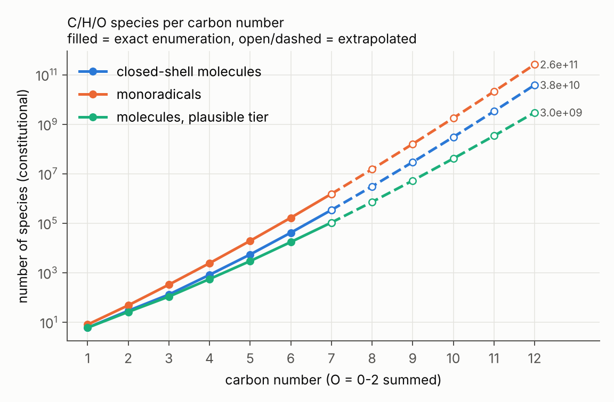
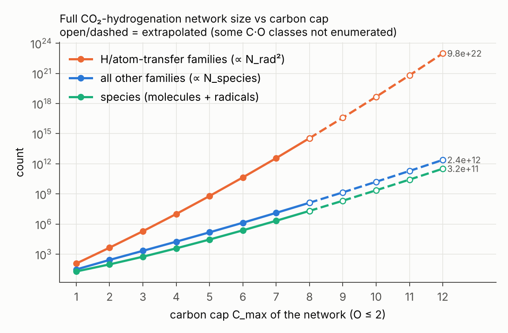
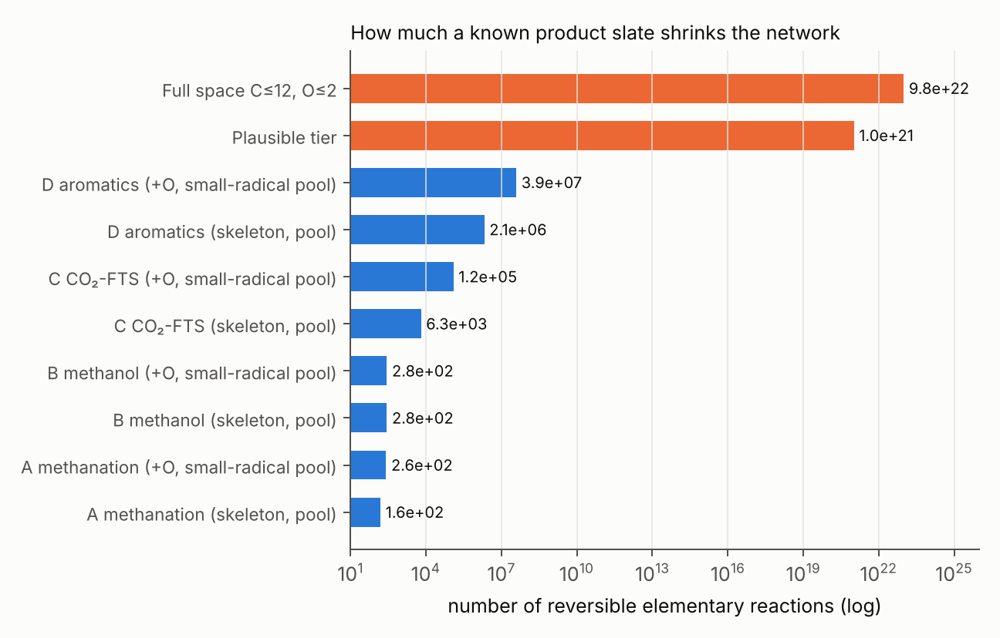

# CO₂ 加氢反应网络：中间体与基元反应的穷举与规模估计（C ≤ 12）

本目录回答三个问题：

1. CO₂ + H₂ 体系里，所有可能的中间体（含自由基）和基元反应是什么？反应物之间、反应物与产物之间、产物与产物之间都可以反应。碳数上限 C12，包括芳烃和任意大小的环。
2. 这个网络有多大（量级）？
3. 如果已知产物分布或终产物，网络能缩小多少？

所有数字都可以用 `scripts/` 复现（见文末）。

---

## 1. 结论速览

| 层级 | 闭壳分子 | 自由基 | 基元反应（可逆，按物种计） |
|---|---|---|---|
| **全空间** C≤12, O≤2，价键允许 | **~4×10¹⁰**（1.6–6×10¹⁰） | **~3×10¹¹** | **~10²³**（1.5×10²²–2×10²³） |
| 去掉高张力/不合理结构（"plausible"） | ~3×10⁹ | ~3×10¹⁰ | ~10²¹ |
| 其中与碳数线性增长的反应族 | | | 2×10¹²（plausible：2×10¹¹） |
| 计入立体异构（C8 已是 ×6.6，C12 预计 ×50–100） | ~10¹²–10¹³ | | 更多 |
| **已知产物**（产物骨架闭包 + 小自由基池） | 10¹–10⁵ | 10¹–10⁶ | **10²–10⁷**（见第 5 节） |

要点：

* **反应数主要来自"任意两个自由基之间的 H 转移"**：H 抽提 RH + Q• → R• + QH，和歧化 R• + Q• → 烯烃 + QH。这两族数目 ∝ N_rad²，C12 时约 10²³，占总量 99.99 % 以上。其他所有反应族（键断裂/自由基复合、自由基加成/β-断裂、成环/开环、H 迁移、脱水、脱羰、酮–烯醇互变、Diels–Alder……）合计只有 ~10¹²，与物种数呈线性。
* 物种数每多一个碳增加约 7–9 倍（数据：C7→C8 为 6.8×，C8→C9 为 7.5×，比值仍在缓慢上升）。所以 C12 网络比 C6 网络大约 6 个数量级（物种）和 12 个数量级（反应）。
* **已知产物后，网络可缩小 15–20 个数量级。** 下降主要来自两点：
  1. 物种只保留产物碳骨架的子结构（及其不同加氢程度和自由基）：从 10¹¹ 降到 10²–10⁵。
  2. 双分子 H 转移的伙伴只保留 C0–C1 小自由基池（H、OH、CH₃、HCO、CH₃O、CH₂OH、HOCO、HCOO……）：这把 N_rad² 变成 N_rad × 10，反应数从平方增长变成线性增长。

  这两步正是 RMG/Genesys 等自动机理生成器用"rate-based"扩展、催化微观动力学里只让 H*/OH*/O* 参与转移时，隐含采用的近似。

---

## 2. 体系定义

**元素与物种**：C、H、O，中性；正常价态 C(4)、O(2)；C ≤ 12，O ≤ 2（C1 物种也限 O ≤ 2：CO₂、HCOOH、CH₂(OH)₂ 等。H₂CO₃ 不在内）。

* 闭壳分子：所有连通的价键图，键级 1–3，任意环数与环大小，芳香环（苯、萘、联苯、苊烯……）都自然包含在内。
* 单自由基：每个闭壳分子在每个带 H 的不等价重原子上去掉一个 H。它与"不等价 H 位点"一一对应，所以 #自由基 = Σ 分子的 H 位点类数。O 中心自由基（RO•、HCOO•）也包含在内。
* 双自由基/卡宾（表面多齿吸附中间体，如 CH*、CCH₂* 的气相类比）只做计数，不进入反应网络：C12 时约 8×10¹¹。
* 特殊物种：H•、H₂、CO。
* 只计构造异构，**不计立体异构**。抽样估计：每个构造异构体平均对应的立体异构体数，在 6 个重原子时为 2.3，8 个重原子时为 6.6。

**过滤规则**

* *raw（价键允许）*：无 O–O 键（还原气氛下过氧化物可忽略）；8 元以下环内无三键、无累积双键碳（环辛炔是最小可分离的环炔）。
* *plausible*：在 raw 基础上，再排除同一原子处于两个 3/4 元环中（双环丁烷、螺戊烷类）、桥环体系（两个 SSSR 环共享 ≥3 个原子，也就排除了反 Bredt 烯烃）、丁三烯及更长的累积多烯。

**生成算法**（`scripts/chem_space.py`）：逐个添加重原子。任何 n+1 原子的连通分子都有一个非割点，删掉它就得到一个合法的 n 原子分子，所以"父分子 + 一个新原子以任意键级连到父分子的任意原子子集"能遍历全部分子。芳香父分子会展开它的所有 Kekulé 结构。用 RDKit 规范 SMILES 去重。过滤规则对子图单调，所以可以在生成过程中剪枝。

验证：C₅H₁₀ = 10，C₆H₁₂ = 25，C₇H₁₆ = 9，C₈H₁₈ = 18，C₄H₁₀O = 7，与已知构造异构体数完全一致。去对称剪枝与不去对称剪枝的计数完全相同。

## 3. 基元反应族

每个反应都定义为局部的成键/断键模式，在物种层面去重（反应物与产物都按规范 SMILES 比较），正逆反应只计一次。

| 反应族 | 形式 | 例子 | 规模 |
|---|---|---|---|
| recomb | R• + R'• ⇌ R–R' | CH₃ + OH ⇌ CH₃OH；C–C 偶联 | 线性 |
| H_recomb | R• + H• ⇌ RH | CH₃O + H ⇌ CH₃OH | 线性 |
| add_H | H• + A=B ⇌ H–A–B• | H + CO₂ ⇌ HOCO / HCOO | 线性 |
| add_beta | R• + A=B ⇌ R–A–B•（β-断裂） | CH₃ + C₂H₄ ⇌ n-C₃H₇ | 线性 |
| ring_open | 环状 R• ⇌ 开链 R•（分子内加成） | 己烯基 ⇌ 环己基；芳环生长 | 线性 |
| co_add | R• + CO ⇌ R–C•=O | CO 插入，OH + CO ⇌ HOCO | 线性 |
| h_shift | R• ⇌ R'•（同母体分子内 H 迁移） | CH₃O ⇌ CH₂OH | Σ C(k,2) |
| elim4 | X–A–B–H ⇌ A=B + HX（四中心） | C₂H₅OH ⇌ C₂H₄ + H₂O；RCOOH ⇌ RH + CO₂ | 线性 |
| elim11 | X–C(=O)–Y ⇌ CO + X–Y | HCOOH ⇌ CO + H₂O；RCHO ⇌ RH + CO | 线性 |
| taut13 | 1,3-H 迁移 | CH₃CHO ⇌ CH₂=CHOH | 线性 |
| diels_alder | 双烯 + 亲双烯体 ⇌ 环己烯 | C₄H₆ + C₂H₄ ⇌ 环己烯（芳构化路径） | 线性 |
| **h_abstr** | RH + Q• ⇌ R• + QH | CH₄ + OH ⇌ CH₃ + H₂O | **N_rad(N_rad−1)/2** |
| **dispro** | R• + Q• ⇌ A=B + QH | 2 C₂H₅ ⇌ C₂H₄ + C₂H₆ | **N_βH × N_rad** |
| **sh2** | Q• + A–B ⇌ Q–A + B• | H + CH₃OH ⇌ CH₄ + OH | ~N_split × N_rad |

计数公式与显式网络的对照（C≤2 全网络，`data/network_full_C2.csv`，96 个物种，4649 个反应）：h_abstr 显式 1653 = C(58,2)，完全一致。dispro 显式 2476，公式 2494：差 0.7 %，因为两个自由基生成相同产物对时只算一个反应。

C1 子网络（19 个物种、141 个反应）中的 CO₂ 活化步骤都能找到：CO₂ + H ⇌ HOCO / HCOO，HOCO ⇌ CO + OH，HCOOH ⇌ CO + H₂O，HCOOH ⇌ CO₂ + H₂，CH₂O + H ⇌ CH₃O / CH₂OH，CH₃OH ⇌ CH₂O + H₂ 等。

## 4. 全空间规模（C≤12, O≤2）

**精确枚举**：C+O ≤ 9 个重原子（78.9 万个分子），烃类到 C10。每个分子都逐一分析其全部反应通道。**外推**：对每个 O 数，把相邻碳数的计数比 r(C) 对 C 做线性拟合并外推；"low" 假设比值冻结在最后一个精确值。每分子平均通道数线性外推，plausible 比例做对数线性外推。

| 碳数 C | 分子 O=0 | O=1 | O=2 | 自由基（合计） | plausible 分子（合计） |
|---|---|---|---|---|---|
| 1 | 1 | 2 | 3 | 8 | 6 |
| 2 | 3 | 8 | 18 | 48 | 26 |
| 3 | 6 | 30 | 95 | 329 | 108 |
| 4 | 27 | 158 | 634 | 2.4×10³ | 553 |
| 5 | 103 | 889 | 4 447 | 1.9×10⁴ | 2.9×10³ |
| 6 | 544 | 5 796 | 34 962 | 1.7×10⁵ | 1.7×10⁴ |
| 7 | 3 084 | 41 739 | 296 815 | 1.5×10⁶ | 1.1×10⁵ |
| 8 | 20 963 | 334 134 | *2.7×10⁶* | *1.5×10⁷* | *7×10⁵* |
| 9 | 157 953 | *2.9×10⁶* | *2.6×10⁷* | *1.6×10⁸* | *5×10⁶* |
| 10 | *1.3×10⁶* | *2.8×10⁷* | *2.7×10⁸* | *1.8×10⁹* | *4×10⁷* |
| 11 | *1.2×10⁷* | *2.9×10⁸* | *3.0×10⁹* | *2.1×10¹⁰* | *3×10⁸* |
| 12 | *1.2×10⁸* | *3.2×10⁹* | *3.5×10¹⁰* | *2.6×10¹¹* | *3×10⁹* |

斜体为外推值，其余为精确值。

按碳上限累计的网络规模（全空间，central 估计）：

| C_max | 闭壳分子 | 自由基 | 线性族反应 | H 转移族反应 | 总反应 |
|---|---|---|---|---|---|
| 1 | 9 | 10 | 30 | 117 | 147 |
| 2 | 38 | 58 | 267 | 4.4×10³ | 4.7×10³ |
| 3 | 169 | 387 | 2.2×10³ | 1.9×10⁵ | 1.9×10⁵ |
| 4 | 988 | 2.8×10³ | 1.8×10⁴ | 1.0×10⁷ | 1.0×10⁷ |
| 6 | 4.8×10⁴ | 1.9×10⁵ | 1.4×10⁶ | 4.4×10¹⁰ | 4.4×10¹⁰ |
| 8 | 3.5×10⁶ | 1.7×10⁷ | 1.3×10⁸ | 3.6×10¹⁴ | 3.6×10¹⁴ |
| 10 | 3.4×10⁸ | 2.0×10⁹ | 1.6×10¹⁰ | 4.7×10¹⁸ | 4.7×10¹⁸ |
| 12 | 4.2×10¹⁰ | 2.8×10¹¹ | 2.4×10¹² | 9.8×10²² | 9.8×10²² |

C12 全空间各反应族（central）：

* H 抽提 4×10²²，歧化 5.6×10²²，SH2 取代 1.8×10²¹
* 开环/成环 8×10¹¹，H 迁移 7×10¹¹（其中 1,2–1,5 迁移 6.6×10¹¹），H 复合 2.8×10¹¹，H 加成 2×10¹¹，四中心消除 1.8×10¹¹，自由基加成 7.7×10¹⁰，C–C/C–O 复合 7.5×10¹⁰，酮–烯醇 5.7×10¹⁰，Diels–Alder 2.7×10⁹，CO 插入 5×10⁸，脱羰 2×10⁸




**存储量参考**：10²³ 个反应即使每个只用 50 字节，也需要 ~5 ZB，远超任何计算机存储，无法显式写出。显式能处理的上限大约是 10⁸–10⁹ 个反应，对应全空间 C_max ≈ 5–6。所以 C12 的"全部反应"只能统计计数，或靠剪枝生成。

## 5. 已知产物分布后的缩减

`scripts/prune.py` 的做法：

1. 物种 = C1 入口化学（所有 C≤1、O≤2 物种）∪ 产物的"骨架闭包"∪ 它们的单自由基。骨架闭包是每个产物的所有连通子骨架，加氢程度从全饱和到产物本身（芳香键可单可双，所以环己烯、环己二烯等氢化芳烃都保留）。
2. "+O"版本：在骨架闭包的每个碳上再加一个 O（C–OH 或 C=O），覆盖 CO 插入/醇路线的含氧中间体（醛、醇、酰基、烯醇）。
3. 反应：所有线性族都在缩减物种集内封闭生成；H 转移/取代类双分子反应的伙伴只保留 C0–C1 小自由基池。

| 场景（典型催化剂） | 产物 | 物种（分子+自由基） | 反应（小自由基池） | 不限伙伴时 |
|---|---|---|---|---|
| A 甲烷化（Ni、NiCu） | CH₄、H₂O（+微量 C₂H₆） | 21 | 155 | 164 |
| B 甲醇（Cu/ZnO、In₂O₃） | CH₃OH、DME、甲酸甲酯 | 28 | 279 | 345 |
| C CO₂-FTS（Fe–K/Na），只含骨架 | C1–C12 正构烷/α-烯/2-烯、2-甲基烷，C1–C6 醇 | 338 | 6.3×10³ | 5.6×10⁴ |
| C CO₂-FTS + 含氧中间体 | 同上 | 5.0×10³ | 1.2×10⁵ | 1.5×10⁷ |
| D 芳烃（氧化物/分子筛，如 ZnZrOx/H-ZSM-5），只含骨架 | 低碳烯烃/烷烃、BTX、C9–C12 烷基苯、萘及甲基萘 | 9.0×10⁴（8 924 分子） | 2.1×10⁶ | 6.5×10⁹ |
| D 芳烃 + 含氧中间体 | 同上 | 1.5×10⁶（1.4×10⁵ 分子） | 3.9×10⁷ | 1.9×10¹² |

缩减比例（与 C≤12 全空间 ~10²³ 个反应相比）：

* 甲烷化/甲醇：≈ 10²⁰–10²¹ 倍，网络在 C1–C2 闭合，与文献微观动力学模型同量级（几十个物种、上百个步骤）。
* CO₂-FTS：≈ 10¹⁸–10¹⁹ 倍（含氧中间体版本 ≈ 10¹⁸）。产物是线性/单甲基链，子骨架很少，所以剩下的网络实际可算。
* 芳烃：≈ 10¹⁵–10¹⁷ 倍。多甲基苯和萘的子骨架与氢化程度组合较多，是最大的场景，但 10⁶–10⁷ 个反应仍可显式生成和求解（含氧版本的反应列表 640 MB，未存入仓库，可用 `prune.py` 重新生成）。



**为什么能缩小这么多？**

1. **骨架约束**：知道终产物，就知道哪些碳骨架会出现。全空间 C12 有 10⁸ 种烃骨架（O 计入后达 10¹⁰），而一条直链 C12 的子骨架只有 12 条直链。
2. **伙伴约束**：H 转移的伙伴实际上由浓度最高的小自由基（或表面 H*、OH*、O*）主导，大自由基之间的 H 交换贡献可以忽略。这一步把 N² 变成 N。
3. 进一步缩减（本目录未做，量级参考）：
   * 按通量/速率剪枝（RMG 的 rate-based 扩展），通常再缩小 10–100 倍。
   * 按同系物/官能团集总（lumping）。FTS 常用 ASF 链增长参数 α，可把 10⁴ 个反应压缩到 ~10² 个"链增长 + 终止"参数。
   * 只保留热力学可及的物种（ΔG 筛选）。

## 6. 与真实催化体系的对应及局限

* 本网络是"气相自由基语言"。在金属/氧化物表面上，R• 对应吸附态 R*，H• 对应 H*，自由基复合对应表面偶联（FTS 中的 C–C 偶联），H 抽提对应表面脱氢（伙伴是 H*/OH*/O*，天然就是"小自由基池"）。表面多齿中间体（C*、CH*、CCH₂* 等）对应双/多自由基：C12 时双自由基 ~8×10¹¹ 个，没有进入反应计数。
* 分子筛"烃池"机理中的碳正离子（甲基苯鎓离子等）、表面甲氧基、甲基环戊烯酮等扩环/缩环中间体，不在中性骨架闭包内；如果需要，可以把它们作为额外产物加入 `prune.py` 的场景列表。
* 共振稳定自由基（烯丙基、苄基）的不同共振式按不同 SMILES 计数，会略微高估自由基数（< 几 %）。
* 立体异构不计（会使 C12 物种数再增加 1–2 个数量级）。
* 外推不确定度约 ±0.5 个数量级（物种）、±1 个数量级（反应），见 `data/estimate_C12.json` 中的 low/central/high。

## 7. 文件与复现

| 路径 | 内容 |
|---|---|
| `scripts/chem_space.py` | 分子生成器、过滤规则、单分子全部反应通道分析 |
| `scripts/enumerate_space.py` | 按重原子数逐层枚举，统计每个 (C,O) 的物种和反应通道 |
| `scripts/reactions.py` | 显式反应网络构建（14 个反应族，正逆去重，可限定伙伴池） |
| `scripts/small_network.py` | C≤1、C≤2 的完整显式网络 |
| `scripts/estimate.py` | 外推到 C12，按反应族计数，立体异构抽样 |
| `scripts/prune.py` | 已知产物场景的网络缩减 |
| `scripts/figures.py` | 图 1–3 |
| `data/species/CHO_O2_h*.smi.gz` | 所有闭壳分子的 SMILES（≤8 个重原子，O≤2） |
| `data/network_full_C1.csv`、`network_full_C2.csv` | C≤1/C≤2 全网络的所有基元反应 |
| `data/network_reduced_*.csv(.gz)` | 各场景缩减网络的反应列表（闭壳物种 >2×10⁴ 的网络只写线性族反应；D 含氧版本不入库） |
| `data/species_reduced_*.txt(.gz)` | 各场景缩减网络的物种列表 |
| `data/stats_*.json`、`estimate_C12.json`、`reduced_networks.json` | 统计与估计结果 |

```bash
pip install rdkit numpy scipy matplotlib
cd scripts
python enumerate_space.py --hmax 9 --omax 2 --tag CHO_O2 --save-max 8   # 4 核约 45 min
python enumerate_space.py --hmax 10 --omax 0 --tag CH --save-max 8      # 烃类到 C10
python small_network.py 1 2
python estimate.py
python prune.py
python figures.py
```
