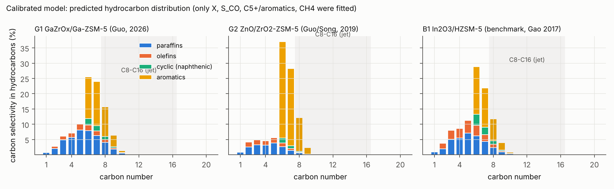
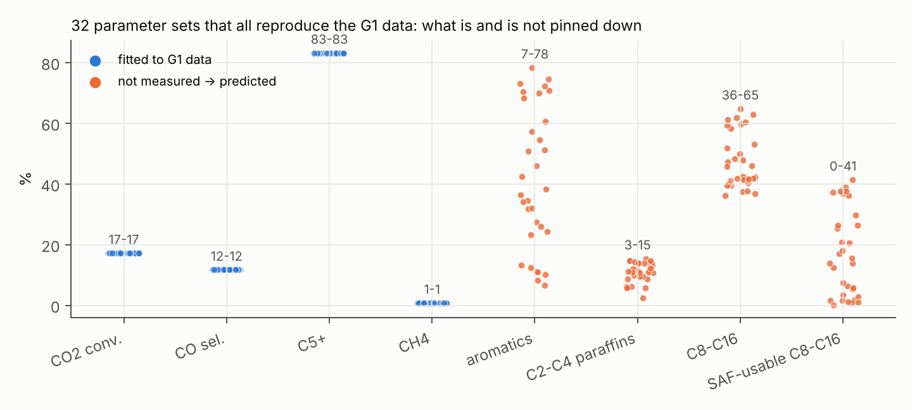
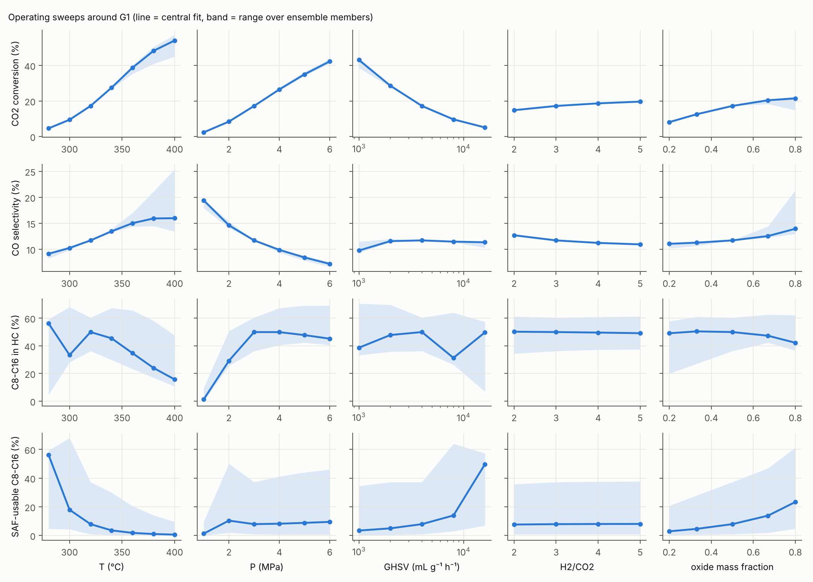
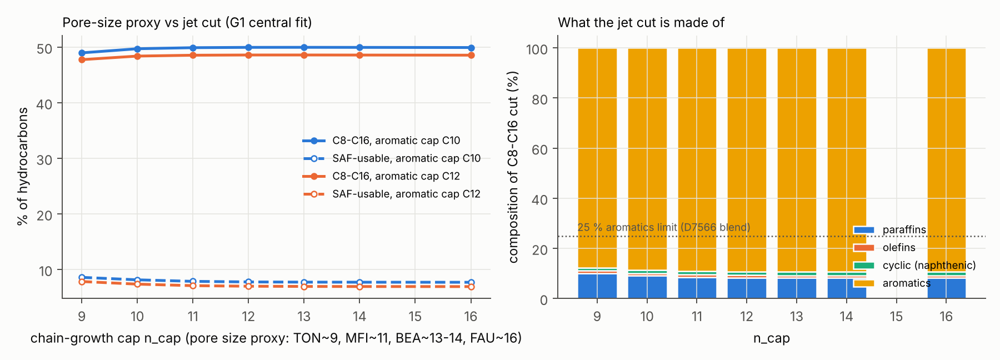
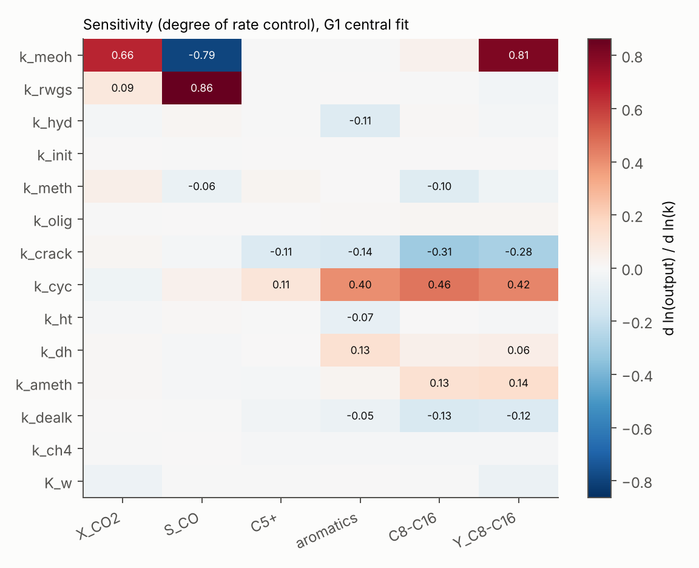
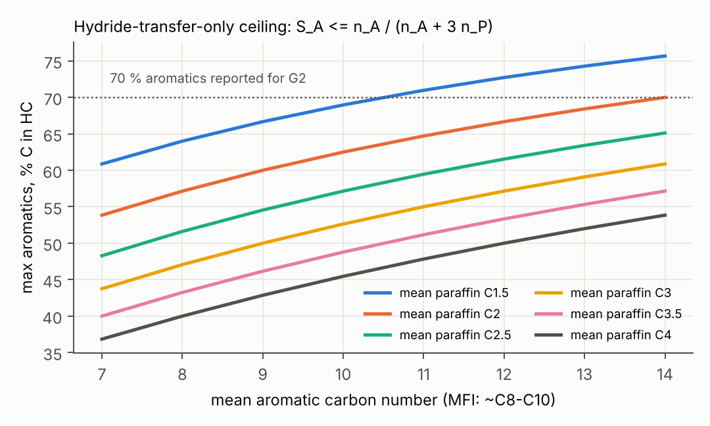

# 氧化物/分子筛（OX-ZEO）CO₂ 一步加氢制航煤：机理网络 + 纯动力学模型

**目的**：在不做催化剂建模的前提下，只用一个机理动力学模型，先回答下面几个问题：
* 产物都是什么、为什么会这样分布；
* 哪一步控制转化率和 CO 选择性；
* 现有文献数据能确定什么、不能确定什么；
* 想要更多航煤（C8–C16，SAF）应该往哪个方向调。

文献依据见 `reports/郭新闻课题组 CO2加氢产物分布.md`。校准数据只有摘要级数字，所以下文的定量结果都要按"趋势/可能范围"来理解。

---

## 1. 机理与反应网络

### 机理

甲醇（及 DME）是氧化物与分子筛之间的中间体。主要证据：用过的 ZSM-5 上固体 NMR 检测到甲醇/DME，DFT 结果也支持甲氧基路线（详见文献报告第 6 节）。

| 位点 | 反应族 | 说明 |
|---|---|---|
| 氧化物（ZnZrOx/GaZrOx/In₂O₃） | OX1 CO₂ + 3H₂ ⇌ CH₃OH + H₂O | 甲酸盐/甲氧基路线；受热力学平衡限制（Bussche–Froment K） |
| | OX2 CO₂ + H₂ ⇌ CO + H₂O | 逆水煤气变换（RWGS），CO 的来源 |
| | OX3 烯烃 + H₂ → 烷烃 | 氧化物上的 H 溢流加氢 |
| 分子筛酸位（H-ZSM-5） | Z1 2CH₃OH ⇌ DME + H₂O | 快速平衡 |
| | Z2 首个 C–C 键 | 慢速引发 |
| | Z3 烯烃甲基化（甲醇/DME） | 烯烃循环 |
| | Z4 齐聚、Z5 β-断裂裂解 | 决定碳数分布 |
| | Z6 环化 → 环状中间体 | |
| | Z7 氢转移芳构化：环状 + 3 烯烃 → 芳烃 + 3 烷烃 | 轻烷烃的主要来源 |
| | Z7b 脱氢芳构化：环状 → 芳烃 + H₂（Ga/Zn Lewis 位） | 见第 3.2 节 |
| | Z8 芳烃甲基化、Z9 脱烷基 | 芳烃循环 |
| | Z10 CH₃OH + H₂ → CH₄ | 副反应 |
| 择形 | 生成 n 碳产物的速率乘以 s(n) = 1/(1+e^{(n−n_cap)/w}) | MFI：链长上限约 C11，芳烃上限约 C10 |

### 网络规模

按"类别 × 碳数"集总，共 72 个物种：烯烃 C2–C20、烷烃 C1–C20、环状中间体 C6–C20、芳烃 C6–C16，以及 CO₂、H₂、CO、H₂O、甲醇、DME。反应共 296 个集总反应加 3 个可逆步骤，全部由反应族规则自动生成，列表见 `network_lumped.csv`。

上一级目录做的是显式自由基网络：C≤12 时有 10²³ 个反应，按产物裁剪后 10⁶–10⁷ 个。这里换成碳正离子化学，并按族集总，规模降到 10² 个反应，单次反应器计算约 0.1 s。

## 2. 校准（只用文献）

| 编号 | 体系 | 拟合目标（摘要数据） | 拟合结果 |
|---|---|---|---|
| G1 | 郭组 GaZrOx/Ga-ZSM-5（Adv. Sci. 2026），320 °C、3 MPa | X = 17.2 %，S_CO = 11.7 %，C5+ = 83.2 %，CH₄ < 1 % | 全部吻合 |
| G2 | 郭组/宋春山 ZnO/ZrO₂–ZSM-5（J. CO₂ Util. 2019），340 °C | X = 9 %，芳烃 = 70 %，CH₄ < 1 % | 全部吻合（需要 Z7b，见 3.2） |
| B1 | 对照（非郭组）In₂O₃/HZSM-5（Gao 等, Nat. Chem. 2017），340 °C、3 MPa、9000 mL g⁻¹ h⁻¹ | X = 13.1 %，S_CO = 44.8 %，C5+ = 78.6 %，CH₄ = 1 % | 全部吻合 |

**摘要缺失、由我假设的条件**：H₂/CO₂ = 3；G1/G2 的 GHSV = 4000 mL g⁻¹ h⁻¹；氧化物:分子筛 = 1:1。另外加了一个软约束：芳烃平均碳数 ≈ 8.7 ± 0.5，依据是 OX-ZEO 芳烃以 C8–C10 为主，这一点不来自这三篇摘要。

参数用对数尺度的正则化最小二乘拟合（`calibrate.py`），结果在 `calibration.json`。



## 3. 只靠动力学模型得到的信息

### 3.1 转化率由氧化物上的甲醇生成决定；分子筛的作用是"抽走甲醇"压低 CO

* 敏感度（degree of rate control，G1 中心拟合，图 f5）：CO₂ 转化率对 k_MeOH 的敏感度为 0.66，对所有分子筛速率常数的敏感度都 < 0.05。所以速率控制步骤在氧化物上，与 In₂O₃/HZSM-5 文献"甲基物种加氢为速控步"的结论一致。
* CO 选择性几乎完全由 k_RWGS / k_MeOH 决定（敏感度 +0.86 / −0.79）。
* 同样的氧化物量：单独氧化物的 CO 选择性为 68–94 %（甲醇卡在平衡上）；与分子筛组合后降到 12–45 %。
* **推论**：要降低 CO，首先要提高氧化物的甲醇活性，或在相同温度下提高 MeOH/RWGS 速率比。分子筛只需"足够快"把甲醇抽走，再快也没有额外收益。

### 3.2 芳烃选择性的氢平衡上限

每生成一个芳环要放出 6 个 H。如果全靠氢转移，就要把 3 个烯烃变成 3 个烷烃，所以

  **S_芳烃 ≤ n_A / (n_A + 3·n̄_P)**

MFI 中芳烃约 C9–C10、伴生烷烃约 C3–C4，上限约 45–53 %（图 f6）。模型在只有氢转移时，无论参数怎么调，芳烃都卡在约 48 %。

G2 报道的 70 % 芳烃（CH₄ < 1 %）只有加入"放出 H₂ 的脱氢芳构化"（Z7b）后才能拟合。热力学上也说得通：从饱和环烷脱氢，在 2–3 MPa H₂ 下不可行（环己烷 → 苯 + 3H₂，K(593 K) ≈ 7 bar³）；从环烯类中间体脱氢则可行（环己烯 → 苯 + 2H₂，K ≈ 5×10³ bar²）。

**推断**：高芳烃 OX-ZEO 催化剂中，Ga/Zn 一类 Lewis 位的脱氢功能是必需的，这与郭组 Ga-ZSM-5/GaZrOx（Ga–H）的方向一致。反过来，想要烷烃型航煤（SPK），就应当抑制这条通道。

### 3.3 现有摘要数据能确定什么，不能确定什么（可辨识性）

用 32 组随机先验重新拟合 G1，每一组都同样精确地复现 X、S_CO、C5+、CH₄（图 f2）。但这些拟合对未测量的量给出完全不同的预测：

| 量 | 32 组拟合的范围 |
|---|---|
| 芳烃 | 7–78 % |
| C8–C16 | 36–65 % |
| SAF 可用 C8–C16（芳烃占切分 ≤ 25 %） | 0–41 % |
| C2–C4 烷烃 | 3–15 % |

**结论**：只有转化率、CO、C5+、CH₄ 这几个数，无法判断一个 OX-ZEO 催化剂的航煤潜力。必须有按碳数 × 族组成（PIONA / GC×GC）的产物数据。这是下一步最关键的实验或文献数据。



### 3.4 MFI 体系中的"航煤馏分"主要是 C8–C10 芳烃

G1/G2/B1 中心拟合的 C8–C16 选择性为 46–60 %，但其中约 88 % 是 C8–C10 芳烃（二甲苯、三甲苯、四甲苯）。按 ASTM D7566 调和时芳烃 ≤ 25 % 的限制，真正"SAF 可用"的部分只有 2–8 %。

把链增长上限从 C9 放大到 C16（相当于 TON → MFI → BEA → FAU）几乎不改变 C8–C16（中心拟合 48–50 %），C17+ 始终约为 0（图 f4）。原因是重链在到达孔口上限之前就被裂解掉了：碳数分布的上端由"生长 vs 裂解"的动力学竞争决定，而不是孔径。

**推论**：单靠换大孔分子筛拿不到 C12–C16，必须同时削弱裂解（降低酸强度/酸密度、降低温度）。

### 3.5 SAF 可用馏分的敏感度与操作趋势

SAF 可用选择性的敏感度（G1 中心拟合）：

| 速率常数 | 敏感度 | 作用 |
|---|---|---|
| 裂解 k_crack | **−0.92** | 最大负面因素 |
| 烯烃加氢 k_hyd | **+0.39** | 把烯烃变成烷烃，减少环化/芳构化原料 |
| 脱氢芳构化 k_dh | −0.35 | |
| 氢转移 k_HT | +0.23 | 产生烷烃 |
| 芳烃甲基化 k_ameth | −0.17 | |

操作变量的影响如下（图 f3）。"12/12"表示在 12 组都能复现 G1 数据的参数中，趋势方向全部一致：

| 操作变量（增大） | CO₂ 转化率 | CO 选择性 | 芳烃 | SAF 可用 | 一致性 |
|---|---|---|---|---|---|
| 温度 280→400 °C | 5 → 53 % | 9 → 18 % | 1 → 44 % | 42 → 2 % | 12/12 |
| 压力 1→6 MPa | 2 → 42 % | 19 → 7 % | ↑ | 1 → 15 % | 10/12 |
| 空速 1000→16000 | 42 → 5 % | ≈ | 46 → 2 %（芳构化是串联次级反应） | 8 → 35 % | 10/12 |
| 氧化物比例 0.2→0.8 | 8 → 21 % | 11 → 14 % | 51 → 22 % | 6 → 29 % | 12/12 |
| H₂/CO₂ 2→5 | 15 → 20 % | 13 → 11 % | 略降 | ≈ | — |

表中数值为 12 组参数结果的中位数。

**核心权衡**：SAF 可用选择性与转化率此消彼长。芳构化是串联反应，转化越深、温度越高，芳烃越多。

按这个模型，烷烃型航煤的方向是：
1. 加氢功能强：高氧化物比例，或加入加氢位；
2. 裂解弱：中等或低酸强度、较低温度；
3. 抑制脱氢芳构化：避免 Ga/Zn Lewis 位；
4. 用较高压力补回转化率。

这与高芳烃催化剂的设计方向正好相反。






## 4. 局限

* 集总模型：同一碳数、同一类别内的异构体反应性相同；iso/normal 比例和 C9–C10 芳烃异构体没有区分。
* 校准数据是摘要级的。GHSV、H₂/CO₂、质量比都是假设，参数不唯一（见 3.3）。所以给出的是趋势和可能范围，不是精确预测。
* 未考虑：失活/积碳、温度梯度和传质、ketene/CO 介导路线、氧化物与分子筛的距离效应、芳烃加氢。
* "SAF 可用"只是按碳数和芳烃 ≤ 25 % 做的简化判据，没有计算冰点、密度、馏程等燃料性质。

## 5. 下一步

1. 拿到一篇有完整 PIONA/碳数分布的 OX-ZEO 数据（郭组全文或其他组），代入集合拟合，把 3.3 中的范围收窄。
2. 用收窄后的模型，在操作条件和"功能强度"空间（加氢/酸强度/脱氢）里找 SAF 可用选择性的上限。这之后才轮到催化剂层面的描述符建模和筛选。

## 6. 文件与复现

| 文件 | 内容 |
|---|---|
| `model.py` | 集总网络生成、热力学、速率方程、PFR（BDF）求解、产物统计 |
| `calibrate.py` | 三个文献案例的正则化拟合 → `calibration.json` |
| `analyze.py` | 集合拟合（可辨识性）、操作扫描、敏感度、孔径扫描 → `results/` |
| `figures.py` | 图 f1–f6 |
| `network_lumped.csv` | 296 个集总反应 |

```bash
cd co2_hydrogenation_network/tandem_kinetics
python calibrate.py      # 约 1 min（4 核）
python analyze.py        # 约 20 min（4 核）
python figures.py
```
