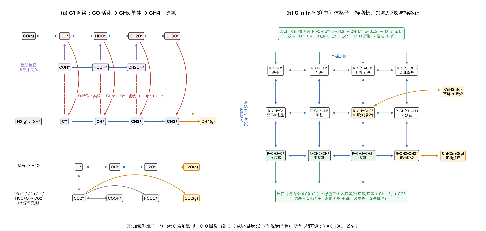

# 费托合成（FTS）生成直链烃的完整基元反应网络

总反应：

- 正构烷烃：`n CO + (2n+1) H2 → CnH2n+2 + n H2O`
- 直链 α-烯烃：`n CO + 2n H2 → CnH2n + n H2O`
- 水煤气变换（副反应）：`CO + H2O ⇌ CO2 + H2`

本目录用脚本按规则**逐碳数枚举**全部表面中间体与可逆基元步骤，不靠手写，因此不会漏项；
每一步都自动校验 C/H/O 原子守恒和表面位点守恒。



## 文件

| 文件 | 内容 |
|---|---|
| `data/reactions_full.md` | **全表**：C1–C20 的 1502 个基元步骤，按碳数和类别分节 |
| `data/reactions.csv` | 同上，机器可读（编号、碳数、类别、方程式、说明） |
| `data/species.csv` | 654 个物种（分子式、C/H/O 数、气相/表面、类型） |
| `scripts/build_network.py` | 生成器；`--nmax N` 可生成到任意碳数 |
| `scripts/plot_network.py` | 示意图 |

```bash
python scripts/build_network.py --nmax 20   # 默认；改成 40、60… 即可延伸
python scripts/plot_network.py              # 需要 matplotlib
```

链增长在原理上没有上限，所以"写全"的唯一办法是给出对任意 n 都成立的规则。
下面 1–4 节是与链长无关的全部步骤（逐条列出），第 5 节是每增加一个碳重复一次的规则；
`reactions_full.md` 是把这些规则展开到 C20 的逐条结果。

## 记号

- `*` 表面空位，`X*` 吸附物种，所有步骤可逆（`⇌`）。
- C_n 烃类中间体写成 `R–CH_a–CH_b*`，R 为正构烷基；`b` 是端位（α）碳的 H 数（0–3），
  `a` 是 β 碳的 H 数（0–2）。共 3×4 = 12 个状态：

| a \ b | 0 | 1 | 2 | 3 |
|---|---|---|---|---|
| **0** | R–C≡C* 炔基 | R–C≡CH* 1-炔 | R–C(*)=CH2 1-烯-2-基 | R–C(*)–CH3 2-亚烷基 |
| **1** | R–CH=C* 亚乙烯基型 | R–CH=CH* 烯基 | **R–CH=CH2\*** 吸附 α-烯烃 | R–CH(*)–CH3 2-烷基 |
| **2** | R–CH2–C* 次烷基 | R–CH2–CH* 亚烷基 | R–CH2–CH2* 烷基 | **R–CH2–CH3\*** 正构烷烃 |

  C2 因两端对称只有 10 个状态：CC、CHC、CH2C、CH3C、CHCH、CH2CH、CH3CH、CH2CH2、CH3CH2、CH3CH3。

## 1. 反应物吸附（2 步）

```
CO(g) + *   ⇌ CO*
H2(g) + 2 * ⇌ 2 H*
```

## 2. CO 活化（16 步）

直接解离（碳化物机理起点）与歧化：

```
CO* + *  ⇌ C* + O*
2 CO*    ⇌ C* + CO2*            (Boudouard)
```

氢助活化——加氢：

```
CO* + H*   ⇌ HCO* + *           CO* + H*   ⇌ COH* + *
HCO* + H*  ⇌ CH2O* + *          HCO* + H*  ⇌ HCOH* + *
COH* + H*  ⇌ HCOH* + *          CH2O* + H* ⇌ CH3O* + *
CH2O* + H* ⇌ CH2OH* + *         HCOH* + H* ⇌ CH2OH* + *
```

氢助活化——C–O 断裂：

```
HCO* + *   ⇌ CH* + O*           COH* + *   ⇌ C* + OH*
HCOH* + *  ⇌ CH* + OH*          CH2O* + *  ⇌ CH2* + O*
CH2OH* + * ⇌ CH2* + OH*         CH3O* + *  ⇌ CH3* + O*
```

## 3. 除氧与水煤气变换（12 步）

```
O* + H*  ⇌ OH* + *              CO* + O*      ⇌ CO2* + *
OH* + H* ⇌ H2O* + *             CO* + OH*     ⇌ COOH* + *
2 OH*    ⇌ H2O* + O*            COOH* + *     ⇌ CO2* + H*
H2O*     ⇌ H2O(g) + *           COOH* + O*    ⇌ CO2* + OH*
                                COOH* + OH*   ⇌ CO2* + H2O*
                                HCO* + O*     ⇌ HCOO* + *
                                HCOO* + *     ⇌ CO2* + H*
                                CO2*          ⇌ CO2(g) + *
```

## 4. C1 加氢：单体生成、链引发与甲烷（5 步）

```
C* + H*   ⇌ CH* + *
CH* + H*  ⇌ CH2* + *            (CH2*：链增长单体)
CH2* + H* ⇌ CH3* + *            (CH3*：链引发物种)
CH3* + H* ⇌ CH4* + *            (甲烷化 = n=1 的链终止)
CH4*      ⇌ CH4(g) + *
```

## 5. 链增长与链终止：C_{n-1} → C_n（对每个 n ≥ 2 重复）

记 C_{n-1} 的"可增长片段"为 `F_a = R'–CH_a*`（a = 0 次烷基、1 亚烷基、2 烷基；
对 C1 是 CH_a*，a = 0–3）。n ≥ 3 时每个碳数有 77 个基元步骤、33 个新物种
（12 个烃类中间体 + 18 个含氧中间体 + 1 个烯丙基 + 2 个气相产物）：

### 5a. C–C 偶联（碳化物机理，12 步/碳数）

```
F_a + CH_b* ⇌ R'–CH_a–CH_b* + *        a = 0,1,2;  b = 0,1,2,3
```

包含经典的各子机理：

- 烷基机理（Brady–Pettit）：`RCH2* + CH2* ⇌ RCH2CH2* + *`
- 亚烷基路径：`RCH* + CH2* ⇌ RCH=CH2* + *`，`RCH* + CH* ⇌ RCH=CH* + *`
- 次烷基路径：`RC* + CH* ⇌ RC≡CH* + *`，`RC* + CH2* ⇌ RC(*)=CH2 + *`
- 与表面碳偶联：`F_a + C*`

C1 + C1 → C2 为 CH_x* + CH_y* 的全部 10 种无序组合。

### 5b–5d. CO 插入机理（Pichler–Schulz，3 + 21 + 18 步/碳数）

```
插入      F_a + CO*                 ⇌ R'–CH_a–CO* + *
C 端加氢  R'–CH_a–CH_pOH_q* + H*    ⇌ R'–CH_a–CH_{p+1}OH_q* + *     p = 0,1; q = 0,1
O 端加氢  R'–CH_a–CH_pO* + H*       ⇌ R'–CH_a–CH_pOH* + *           p = 0,1,2
C–O 断裂  R'–CH_a–CH_pO* + *        ⇌ R'–CH_a–CH_p* + O*            p = 0,1,2
          R'–CH_a–CH_pOH* + *       ⇌ R'–CH_a–CH_p* + OH*           p = 0,1,2
```

即每个片段对应 6 个含氧中间体（–CO 酰基、–COH、–CHO、–CHOH、–CH2O、–CH2OH），
C–O 断裂后落回上表的格点 (a, p)。

### 5e. 烯醇/羟基卡宾缩合机理（Storch–Anderson，1 步/碳数）

```
2 HCOH*            ⇌ CH–COH* + H2O*
R–C(OH)* + HCOH*   ⇌ R–C–COH* + H2O*
```

### 5f. 烯基机理（Maitlis，3 步/碳数，n ≥ 3）

```
R'CH=CH* + CH2*      ⇌ R'CH–CH–CH2* (η3-烯丙基) + *
R'CH–CH–CH2*         ⇌ R'CH2–CH=CH*                  (1,3-H 迁移 → 高一级烯基)
R'CH–CH–CH2* + H*    ⇌ R'CH2–CH=CH2* + *             (→ 吸附 α-烯烃)
```

### 5g. C_n 中间体加氢/脱氢（17 步/碳数；C2 为 12 步）

上面 3×4 表中所有相邻格点之间：

```
α-碳   R–CH_a–CH_b* + H* ⇌ R–CH_a–CH_{b+1}* + *      (9 步)
β-碳   R–CH_a–CH_b* + H* ⇌ R–CH_{a+1}–CH_b* + *      (8 步)
```

其中决定产物的两步链终止：

- **烷基加氢 → 正构烷烃**：`RCH2CH2* + H* ⇌ RCH2CH3* + *`
- **烷基 β-H 消除 → α-烯烃**：`RCH2CH2* + * ⇌ RCH=CH2* + H*`

### 5h. 产物脱附 / 再吸附（2 步/碳数）

```
RCH2CH3*  ⇌ CnH2n+2(g) + *
RCH=CH2*  ⇌ CnH2n(g) + *
```

因为所有步骤可逆，二次反应已包含在网络内：α-烯烃再吸附（5h 逆向）→ 二次加氢成烷烃、
重新引发链增长，以及氢解（5a 逆向，C–C 断裂）。

## 规模

| | 物种 | 基元步骤 |
|---|---|---|
| 通用 + C1（第 1–4 节） | 24 | 35 |
| C1 → C2 | 36 | 81 |
| 每增加一个碳（n ≥ 3） | 33 | 77 |
| **合计到 C20** | **654** | **1502** |

## 范围说明

- 只追踪**直链**骨架：C–C 成键只发生在链端碳上，不含支链化（CH_x 加到链内碳）。
- 气相产物为正构烷烃和直链 α-烯烃。含氧中间体只作为链增长的过渡物种，
  不设醇/醛/酸的脱附（甲醇、高级醇等含氧产物不在本网络内）。
- 不含双键位移生成内烯烃（2-烯烃等）和催化剂本体变化（碳化、氧化、积碳成石墨）。
- 网络是与催化剂无关的"并集"：Co、Fe、Ru 上各条路径的相对重要性不同
  （例如 CO 直接解离 vs 氢助解离、碳化物 vs CO 插入），这里列出所有被提出的路径，
  不含能垒和速率常数，也不判断哪条占主导。
- 每个吸附物种按占 1 个位点计，仅用于位点守恒记账。
