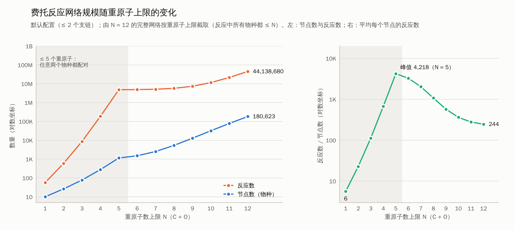

# 费托合成（FT）气相自由基反应网络枚举

> 全部进展、结论与下一步见 [HANDOFF.md](HANDOFF.md)；随机参数 MKM（进行中）见 [mkm/README.md](mkm/README.md)。

从 CO + H₂ 出发，按 **b1f0 / b0f1 / b1f1** 三类基元反应反复迭代，直到网络不再产生新物种，
得到最多 25 个重原子（C + O）的反应网络。物种的 Lewis 结构（键级、形式电荷、自由基位置）
和去重校验由 [YARP](https://github.com/Savoie-Research-Group/yarp)（Savoie 组）完成。

> 注意：PyPI 上的 `pip install yarp` 是另一个同名的响应式编程库，不是这里用的 YARP。

## 为什么没有直接调用 YARP 的 `enumerate_products`

在 YARP 3.0.1 上实测 `enumerate_products`：

| 现象 | 例子 |
|---|---|
| concerted 模式忽略 `n_form`，b1f0 和 b1f1 结果完全一样 | `CC[CH2]` 的 b1f0 = b1f1 = 8 组产物 |
| sequential 模式的 b0f1 返回空 | `[CH3].[CH3]` 得不到乙烷 |
| 自由基加成到 π 键不在 b0f1 中 | H· + CO → HCO· 只能在 b1f1 里找到 |
| 会生成带电的产物 | `[C-]#[OH+2]`、`[C-]=[O+2]=C` 等 |

所以这里自己写了一层很薄的枚举（`ftc_enum/rules.py`），只沿用 YARP 的约定：
**b/f 数的是原子之间的 σ 连接（邻接矩阵的变化），键级由 Lewis 结构重新确定。**

| 类型 | 含义 | 例子 |
|---|---|---|
| **b1f0** | 断 1 个 σ 键 | 均裂（C–H、C–C、C–O、O–H、H₂）、β-断裂（丙基 → 乙烯 + CH₃） |
| **b0f1** | 成 1 个 σ 键 | 自由基结合（CH₃ + CH₃）、加成到 π 键（H + CO → HCO，CH₃ + CO → 乙酰基，CH₃ + C₂H₄ → 丙基）、卡宾二聚 |
| **b1f1** | 断 1 成 1，两键共用一个原子 | 分子间：H 抽提、歧化（2 C₂H₅ → C₂H₆ + C₂H₄）、H₂ + R → RH + H；分子内：H 迁移（含酮–烯醇互变）、重原子基团迁移（距离不限于 1,2） |

`b1f0` 和 `b0f1` 互为逆反应，所以两者的数量总是相等，这是一个自洽性检查。

## 物种的定义

* **只看连接关系**：一个物种 = 重原子组成的树 + 每个重原子上的 H 数（和 YARP 的 yarpecule 由邻接矩阵唯一确定一致）。
  不区分立体异构，也不区分单重态 / 三重态（例如 CH₂ 只有一个物种）。
* **键级**：把每个原子的剩余价两两配成 π 键（在树上贪心配对是最优的），剩下的叫**自由价**
  （free valence）：CH₃ = 1，CH₂ = 2，CH = 3，C = 4；CO 写成 `[C]=O`，自由价为 2。
  YARP 给出的 Lewis 结构（如 `[C-]#[O+]`）在 `--yarp` 时另外输出。
* **不成环**，**不允许 O–O 键**（进料中没有 O₂），不带电荷。
* 这是**纯气相自由基模型**，不显式描述催化剂表面；CHₓ、HCO、OH 等可以看作表面物种的气相类比。

## 双分子反应的配对规则

| 组合 | 是否计算 |
|---|---|
| A + A（同种两分子） | 总是 |
| 任意物种 + 小分子池（≤ `pool_max_heavy` = 3 个重原子：H、H₂、CO、HCO、OH、CHₓ、C₂Hₓ …） | 是 |
| 小分子段内部（两者都 ≤ `full_max_heavy` = 5 个重原子） | 全部两两计算 |
| 大分子 + 大分子 | 否（配对数 ~ 物种数²，做不到 C25） |

分子间 b1f1 默认要求接受方是开壳层（自由基 / 卡宾）。打开
`b1f1_bimolecular_open_shell_acceptor: false` 会加入 CH₄ + C₂H₄ → CH₃ + C₂H₅ 这类
闭壳层分子之间的 H 转移。分子间 SH2 取代与重原子片段转移（`b1f1_bimolecular_group_transfer`）默认关闭。

## 规模（实测）

`count_species.py` 按过滤条件直接数物种；N ≤ 9 时与网络闭包得到的物种数完全一致。
默认限制：大分子（> 5 个重原子）最多 1 个 O、1 个 π 键、1 个自由价。

每层物种数（恰好 N 个重原子）：

| N | 直链 (`max_branches: 0`) | ≤ 1 个支链 | ≤ 2 个支链（默认） |
|---|---:|---:|---:|
| 6 | 189 | 340 | 364 |
| 8 | 648 | 2,031 | 2,801 |
| 10 | 1,827 | 9,420 | 18,932 |
| 12 | 4,416 | 34,931 | 103,431 |
| 13 | 6,555 | 62,721 | 223,088 |
| 14 | 9,469 | 108,215 | — |
| 19 | 44,027 | — | — |
| **累计到 25（外推）** | **约 8 × 10⁵** | **约 3 × 10⁷** | **约 5 × 10⁸** |

每个大分子平均产生约 150–800 个反应（主要是与小分子池的 H 转移）。

### 完整网络实测（默认配置 `config.yaml`，4 核）

| | N = 9 | N = 12 |
|---|---:|---:|
| 物种数 | 12,773 | 180,623 |
| 反应数 | 7,288,960 | 44,138,680 |
| b1f0 / b0f1 / b1f1 | 57,212 / 57,212 / 7,174,536 | 771,282 / 580,397 / 42,787,001 |
| 耗时 | 64.5 s | 15.6 min |
| 峰值内存（所有进程） | — | ~0.8 GB |
| 反应表 | 33 MB（`--compact`） | 212 MB（`--compact`） |

* 两次的物种数都与 `count_species.py` 的预测完全一致：闭包到达了所有满足条件的物种。
* N = 9 时与优化前的代码逐条比对，物种和反应完全相同（优化前 4 核 7.5 分钟、未压缩反应表 550 MB）。
* N = 9 的 12,773 个物种用 YARP 注释（`--yarp`）全部成功，yarpecule hash 无重复（4 核 22 s）；
  其中 182 个卡宾类物种 YARP 给出两性离子 Lewis 结构（如 `[C]=O` → `[C-]#[O+]`）。
* 从 N = 10 起 b1f0 多于 b0f1：例如 C10 → C4 + C6 的均裂会被枚举，但 C4 + C6 两者都不在小分子池、
  也不都在小分子段，按配对规则不计算它们的结合。

从 N = 12 的结果按重原子上限截取子网络（反应中所有物种都 ≤ N；`subnet_stats.py` 生成
`results/subnet_scale_n12.csv`，`plot_scale.py` 画出 `results/scale_vs_max_heavy.png`）：




| N | 物种（节点） | 反应 | 平均每个节点 |
|---:|---:|---:|---:|
| 5 | 1,135 | 4,787,731 | 4,218 |
| 6 | 1,499 | 4,862,867 | 3,244 |
| 7 | 2,514 | 5,076,360 | 2,019 |
| 8 | 5,315 | 5,674,971 | 1,068 |
| 9 | 12,773 | 7,288,960 | 571 |
| 10 | 31,705 | 11,412,999 | 360 |
| 11 | 77,192 | 21,368,890 | 277 |
| 12 | 180,623 | 44,138,680 | 244 |

≤ 5 个重原子的小分子段是固定开销（约 479 万个反应）；之后每个新物种约带来 220 个反应。

### 外推到 25 个重原子

按 N = 12 的吞吐量（每个大分子约 0.02 核秒，压缩反应表每个反应约 5 字节）估算，
更大的分子会更慢一些：

| 方案 | 物种数 | 反应数 | 计算量 | 压缩反应表 |
|---|---:|---:|---:|---:|
| 全部 ≤ 2 个支链（`config.yaml`） | ~5 × 10⁸ | ~10¹¹ | ~4000 核时 | ~500 GB |
| 全部 ≤ 1 个支链 | ~3 × 10⁷ | ~10¹⁰ | ~250 核时 | ~50 GB |
| ≤ 12 个重原子允许 2 个支链，13–25 只保留直链（`config_c25_tiered.yaml`） | ~1.0 × 10⁶ | ~3 × 10⁸ | ~10 核时 | ~1.5 GB |
| 全部直链 | ~8 × 10⁵ | ~2 × 10⁸ | ~10 核时 | ~1 GB |

`config_c25_tiered.yaml` 的物种数在 N ≤ 21 时是 `count_species.py` 的精确计数（累计 461,333），
N = 22–25 按每层约 1.28 倍外推。

## 安装

```bash
pip install -r requirements.txt     # rdkit、pyyaml；YARP 及其依赖只在 --yarp 时需要
```

YARP 官方推荐用 conda（`environment.yml`，Python 3.10）；在 Python 3.13 + pip 下也测试可用。

## 使用

```bash
cd ftc_network

# 1. 先估算规模（只数物种，不枚举反应）
python count_species.py --max-heavy 14 --max-branches 2

# 2. 枚举网络（多进程并行）；大规模时加 --compact（gzip、不带反应 SMILES）
python run_enumeration.py -o output_n12/ --max-heavy 12 --nproc 4 --compact
python run_enumeration.py -c config_c25_tiered.yaml -o output_c25/ --nproc 32 --compact

# 小规模试跑 + 用 YARP 生成 Lewis 结构并校验去重
python run_enumeration.py -o output_small/ --max-heavy 4 --yarp

# 3. 按重原子上限统计子网络规模并画图
python subnet_stats.py output_n12/ -o results/subnet_scale_n12.csv
python plot_scale.py results/subnet_scale_n12.csv -o results/scale_vs_max_heavy.png   # 需要 matplotlib

# 4. 测试
python -m pytest -q tests
```

命令行参数 `--max-heavy`、`--max-branches`、`--max-species` 会覆盖 `config.yaml` 中的同名设置。

## 输出

| 文件 | 内容 |
|---|---|
| `species.csv` | `species_id, smiles, formula, heavy_atoms, nC, nH, nO, free_valence, n_pi, branches, connectivity_key` |
| `reactions.csv` | `rxn_id, type (b1f0/b0f1/b1f1), molecularity, reactant_ids, product_ids, reaction_smiles`（有向，逆反应单独列出） |
| `reactions.csv.gz` | （`--compact`）`type, reactant_ids, product_ids`；行号（从 0 起，不含表头）即 rxn_id，SMILES 可由 `species.csv` 还原 |
| `summary.json` | 物种数、各类反应数、按重原子数统计、所用配置 |
| `species_yarp.csv` | （`--yarp`）YARP 的 Lewis 结构 SMILES、yarpecule hash、自由基电子数、形式电荷，以及 hash 重复检查 |

## 代码结构

```
ftc_network/
├── config.yaml            # 所有限制条件与开关（全部 ≤ 2 个支链）
├── config_c25_tiered.yaml # C25 可行版：≤ 12 个重原子 2 个支链，更大的只保留直链
├── run_enumeration.py     # 主程序
├── count_species.py       # 规模估算
├── subnet_stats.py        # 按重原子上限统计子网络的节点数与反应数
├── plot_scale.py          # 画规模随重原子上限变化的图
├── results/               # 实测 summary、子网络规模表与图
├── ftc_enum/
│   ├── species.py         # 物种表示、键级分配、规范键
│   ├── rules.py           # b1f0 / b0f1 / b1f1 规则
│   ├── network.py         # 闭包迭代、配对规则、并行
│   └── yarp_annotate.py   # YARP Lewis 结构注释
├── tools/                 # 物种化学分类、两次运行比对
├── mkm/                   # 表面网络 + 随机能量 + MKM（进行中）
├── HANDOFF.md             # 交接文档
└── tests/test_rules.py
```
